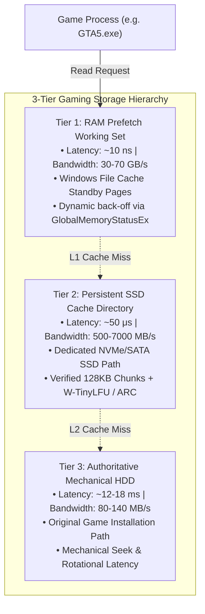

# System Architecture Specification

**Project**: Smart Game Cache  
**System**: Intelligent HDD Gaming Acceleration Engine  
**Target Environment**: Windows 11 / Windows 10 (x64)  
**Target Framework**: .NET 10 LTS (C# 14 / WPF MVVM) & Native C++ (Minifilter)  

---

## 1. Architectural Principles & Invariants

Smart Game Cache is built around three foundational engineering invariants:

1. **The Original HDD is Authoritative**:
   - The game's original installation folder on the mechanical hard drive remains the single, unmodified source of truth.
   - The caching engine operates exclusively in **read-only caching mode**.
   - Game executables, binaries, texture packages, audio banks, and configuration files are never modified, patched, or moved.
   - If the caching engine fails, is terminated, or the SSD cache directory is deleted, the game continues to launch and run directly from the HDD without interruption.

2. **Zero Memory Bloat & Native Cache Coexistence**:
   - Rather than permanently locking gigabytes of physical RAM into private unmanaged memory allocations, Smart Game Cache utilizes the **Windows Cache Manager (`Cc`)** and standby page pool.
   - Files are pre-read into Windows file cache using asynchronous sequential scans. If the game or operating system experiences memory pressure, Windows can immediately repurpose or discard standby pages without paging to disk.

3. **Process-Bound Scoped Acceleration**:
   - Monitoring, learning, and caching are strictly confined to the target game process (`PID`) and its child processes.
   - Background Windows operations (Defender, indexing, Windows updates) are ignored, preventing cache pollution.

---

## 2. Multi-Tier Storage Hierarchy

---

## 3. Subsystem Architecture & Component Breakdown

```mermaid
flowchart LR
    subgraph UI ["Presentation Layer (SmartGameCache.UI)"]
        MainWindow["MainWindow (Sidebar Shell)"]
        Dashboard["Dashboard View & Charts"]
        Games["My Games Library"]
        CacheMgr["Cache Manager Sliders"]
        Analytics["Performance Analytics"]
        History["Learning History Table"]
        Hardware["Hardware Test Mode"]
        Settings["Settings & Elevation"]
    end

    subgraph ServiceLayer ["Orchestration & Background Service"]
        Orchestrator["GameCacheOrchestrator"]
        Detector["GameDetectionService"]
        AnalyticsSvc["AnalyticsService"]
    end

    subgraph CoreEngines ["Core Domain Engines (SmartGameCache.Core)"]
        EtwMonitor["EtwFileIoMonitor (Kernel Trace)"]
        ProcessMonitor["ProcessFileIoMonitor (Standard Fallback)"]
        LearningEng["LearningEngine (W-TinyLFU + ARC)"]
        SsdMgr["SsdCacheManager (Chunk Storage)"]
        RamMgr["RamPrefetchEngine (Standby Warmer)"]
        MemBalancer["NativeMemory Balancer (GlobalMemoryStatusEx)"]
    end

    subgraph DataLayer ["Persistence Layer"]
        SQLiteDB[("SQLite Database\n(SmartGameCache.db WAL)")]
    end

    subgraph DriverLayer ["Optional Transparent Layer"]
        Minifilter["Windows Minifilter Driver\n(SmartGameCache.sys)"]
    end

    UI --> ServiceLayer
    ServiceLayer --> CoreEngines
    CoreEngines --> DataLayer
    CoreEngines -.-> DriverLayer
```

---

## 4. Subsystem Details

### 4.1 Game Detection Engine (`SmartGameCache.Core.Detection`)
- **Steam Integration**: Traverses `HKCU\Software\Valve\Steam\SteamPath` and mounted library roots discovered in `steamapps/libraryfolders.vdf`. Parses manifests (`appmanifest_*.acf`) to identify install paths, game titles, and main binaries.
- **Epic Games Integration**: Scans `%ProgramData%\Epic\EpicGamesLauncher\Data\Manifests\*.item`, extracting `DisplayName`, `InstallLocation`, and `LaunchExecutable`.
- **Rockstar Games Integration**: Reads registry keys under `HKLM\SOFTWARE\WOW6432Node\Rockstar Games`.
- **Physical Drive & Media Inspection**: Queries WMI (`MSFT_PhysicalDisk` / `Win32_DiskDrive`) to inspect the target drive letter, checking whether the source media is a rotational mechanical HDD (MediaType = 3) or solid-state storage (MediaType = 4 / NVMe).

### 4.2 File I/O Monitoring Subsystem (`SmartGameCache.Core.Monitoring`)
- **Kernel ETW Session**:
  - Starts an `NT Kernel Logger` session using `Microsoft.Diagnostics.Tracing.TraceEvent`.
  - Enables `KernelTraceEventParser.Keywords.DiskFileIO`, `FileIOInit`, and `Process`.
  - Subscribes to `FileIORead` to capture `Offset`, `IoSize`, `ProcessID`, and `TimeStamp`.
  - Maps `FileKey` and `FileObject` to full file paths from `FileIOCreate` and `FileIOName`.
  - Filters strictly for the target game process ID and game root path.
  - Monitors `TraceEventSession.EventsLost` to detect event drops under heavy load.
- **Process I/O Monitor (Standard Graceful Fallback)**:
  - If the application is launched without administrative elevation, automatically engages fallback monitoring using Win32 `GetProcessIoCounters`.
  - Periodically samples delta read operations and transfer bytes, preventing crashes while signaling the user via the UI elevation banner.

### 4.3 Intelligent Learning & Scoring Engine (`SmartGameCache.Core.Learning`)
- **Phase-Aware Classification**:
  - *Startup Phase* ($t \le 60\text{ s}$ from process launch): Captures splash assets, engine binaries, configuration files, and initial shader archives.
  - *Gameplay Phase*: Tracks recurring asset streaming (textures, audio streams, level geometry).
- **Chunk-Level Frequency Sketch (TinyLFU)**:
  - Employs a Count-Min 4-bit sketch with periodic half-life aging.
  - New candidate chunks are admitted into the cache only if their estimated access frequency exceeds that of the eviction victim.
- **Adaptive Replacement Cache (ARC)**:
  - Organizes cached chunks into two active lists ($T_1$ for recency, $T_2$ for frequency) and two ghost history lists ($B_1, B_2$).
  - Self-tunes target size parameter $p$ dynamically based on workload characteristics.

### 4.4 Persistent SSD Cache Engine (`SmartGameCache.Core.Storage`)
- **Chunked File-Region Storage**:
  - Instead of mirroring monolithic multi-gigabyte `.rpf`/`.pak` archives, files are divided into configurable 128 KB chunks.
  - Chunks are stored in a deterministic directory structure: `<SsdCacheDirectory>\<GameId>\<PathHash>\<ChunkIndex>.chunk`.
- **Integrity Validation**:
  - Verifies original file existence, byte length, and UTC last write timestamp before serving.
  - If a game patch updates an original file, cached chunks for that file are automatically invalidated and purged.
- **Quota Enforcement**:
  - Blended LFU/LRU eviction enforces user-configured SSD capacity limits (5–100 GB).

### 4.5 RAM Prefetch Engine (`SmartGameCache.Core.Prefetch`)
- **Windows Cache Manager Standby Warming**:
  - Streams high-priority cached chunks from SSD using `FileOptions.SequentialScan`.
  - Windows Cache Manager (`CcCopyRead`) loads the pages into the system standby page list.
- **Dynamic Memory Pressure Balancer**:
  - Queries Win32 `GlobalMemoryStatusEx` before each file chunk read.
  - If physical memory load exceeds 85% or available system RAM falls below 1.5 GB, prefetching immediately pauses or halts to safeguard game launch stability.

### 4.6 SQLite Persistence Layer (`SmartGameCache.Core.Database`)
- **Database Engine**: SQLite 3 using `Microsoft.Data.Sqlite` in Write-Ahead Logging (WAL) mode (`PRAGMA journal_mode=WAL; PRAGMA synchronous=NORMAL;`).
- **Normalized Schema**:
  - `Games`: Executable path, install directory, media type, launcher source.
  - `GameProfiles`: Learned session count, SSD quota, RAM budget, hit rate.
  - `GamingSessions`: Session timestamps, duration, total bytes read, read operations count, cold vs warm flag.
  - `ObservedFiles`: Relative path, total bytes, access count, startup flag, priority score.
  - `CachedFiles` & `CachedChunks`: Chunk offset, size, cache path, validation status, priority score.
  - `ApplicationSettings`: Persistent user configuration.

---

## 5. Security & Anti-Cheat Boundary

- **No Code Injection**: The application never uses `CreateRemoteThread`, `VirtualAllocEx`, API hooking, or DLL injection into game processes.
- **Anti-Cheat Safe**: Game binaries and game process memory remain 100% untouched. EAC, BattlEye, Vanguard, and Valve Anti-Cheat (VAC) remain completely unaffected because all monitoring occurs externally via standard Windows ETW and Win32 process queries.

