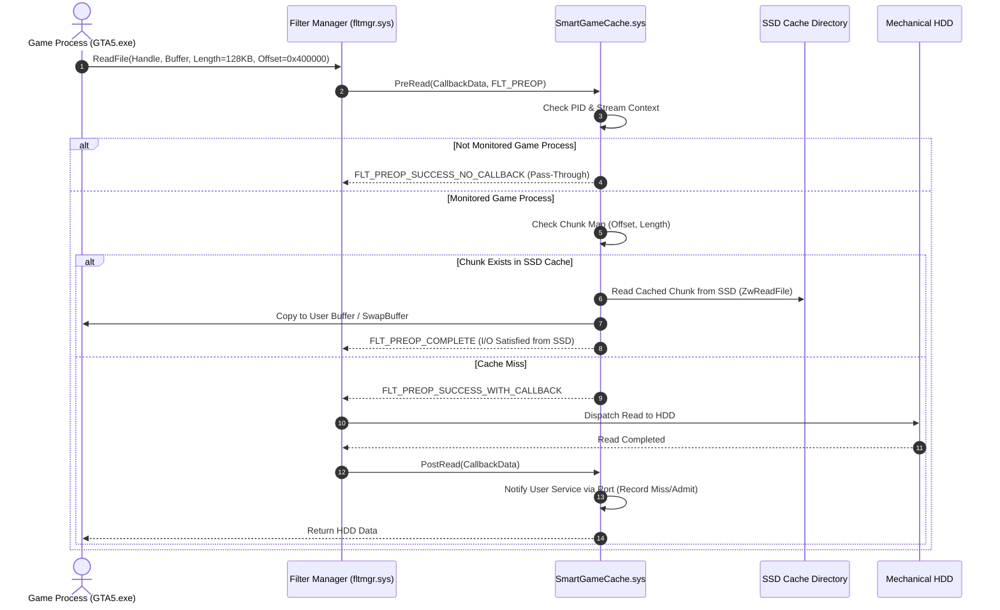

# Windows Filesystem Minifilter Driver Design Specification

**Component**: `SmartGameCache.sys` (Kernel-Mode Filesystem Filter)  
**Architecture**: Microsoft Windows Filter Manager Framework (`fltmgr.sys`)  
**Target OS**: Windows 11 / Windows 10 (x64)  
**Filter Altitude**: `370050` (FSFilter Virtualization / HSM / Caching Category)  

---

## 1. Architectural Role & Boundary

The `SmartGameCache.sys` driver serves as the optional transparent I/O interception milestone. 

### Separation Principle:
- The user-mode desktop application (`SmartGameCache.exe`) and background service handle all **learning, SQLite indexing, game detection, memory balancing, and prefetching**.
- The kernel driver is strictly an **I/O filter**: it intercepts read requests (`IRP_MJ_READ`) aimed at monitored HDD game files and satisfies them from validated SSD cache chunks when available, transparently falling back to the original HDD upon cache misses.
- **Safety First**: The driver contains zero telemetry tracking, no disk partitioning logic, and no network calls. If the driver is unloaded or encounters an internal fault, it returns `FLT_PREOP_SUCCESS_NO_CALLBACK`, allowing the original HDD read to complete unimpeded.

---

## 2. Kernel-Mode I/O Interception Flow



---

## 3. Minifilter Registration & Callbacks

### 3.1 Registration Structure (`FLT_REGISTRATION`)
```c
CONST FLT_OPERATION_REGISTRATION Callbacks[] = {
    { IRP_MJ_CREATE,
      0,
      SmartCachePreCreate,
      SmartCachePostCreate },

    { IRP_MJ_READ,
      0,
      SmartCachePreRead,
      SmartCachePostRead },

    { IRP_MJ_CLEANUP,
      0,
      SmartCachePreCleanup,
      NULL },

    { IRP_MJ_FILE_SYSTEM_CONTROL,
      0,
      SmartCachePreFileSystemControl,
      NULL },

    { IRP_MJ_OPERATION_END }
};
```

### 3.2 Key Operations Handling:
1. **`IRP_MJ_CREATE`**:
   - Evaluates process ID: `FltGetRequestorProcessId(Data)`.
   - If the requesting process matches the monitored game PID, attaches an `FLT_STREAM_CONTEXT` containing the game ID and relative file path.
   - Subsequent reads inspect this stream context in $O(1)$ time without string parsing or path queries.

2. **`IRP_MJ_READ`**:
   - Checks `Data->Iopb->Parameters.Read.ByteOffset` and `Data->Iopb->Parameters.Read.Length`.
   - Checks if I/O is non-cached (`IRP_NOCACHE`), paging I/O (`IRP_PAGING_IO`), or memory-mapped (`CcCopyRead`).
   - If the target region is marked cached in the stream context lookup table, reads data from the corresponding SSD cache file using `FltCreateFileEx` and `FltReadFile`, copies bytes into `Data->Iopb->Parameters.Read.ReadBuffer`, sets `Data->IoStatus.Status = STATUS_SUCCESS`, and completes the request with `FLT_PREOP_COMPLETE`.

3. **`IRP_MJ_FILE_SYSTEM_CONTROL` (BypassIO Compliance)**:
   - When control code is `FSCTL_MANAGE_BYPASS_IO`:
     - If the volume is SSD/NVMe: passes through without modification (`FLT_PREOP_SUCCESS_NO_CALLBACK`).
     - Mechanical HDDs do not support BypassIO; the driver ensures safe standard execution.

---

## 4. User-Kernel Communication Protocol

Communication utilizes Windows Filter Manager Communication Ports:
- **Port Name**: `\SmartGameCachePort`
- **Creation**: `FltCreateCommunicationPort(&ServerPort, ...)`
- **Security**: ACL restricted to `SeDebugPrivilege` / `GENERIC_ALL` for Administrators and `LocalSystem`.
- **Command Structure**:
```c
typedef enum _SMART_CACHE_COMMAND {
    CMD_ATTACH_GAME_PROCESS = 1,
    CMD_DETACH_GAME_PROCESS = 2,
    CMD_REGISTER_CACHED_CHUNK = 3,
    CMD_INVALIDATE_CHUNKS = 4,
    CMD_QUERY_DRIVER_STATS = 5
} SMART_CACHE_COMMAND;
```

---

## 5. Driver Signing & Distribution Requirements

For production distribution on 64-bit Windows 10 and Windows 11:
1. **Driver Signature Enforcement (DSE)**: Windows requires all kernel-mode drivers to be signed with an Extended Validation (EV) Code Signing Certificate and submitted to Microsoft Hardware Dev Center (WHQL).
2. **Safe Standby Mode**: Until WHQL signing is completed, the user-mode application operates in **Standby / Standalone Acceleration Mode**, utilizing the RAM Prefetch Engine and Windows Cache Manager warming without requiring test signing (`bcdedit /set testsigning on`) or compromising operating system security.

