# Hardware Performance & Benchmarking Test Plan

**Project**: Smart Game Cache  
**Scope**: Empirical Evaluation of HDD Acceleration Across Real Storage Hardware  
**Date**: November 2026  

---

## 1. Hardware Matrix & Environments

To prove genuine, measurable storage acceleration, benchmarks must be executed across real physical storage devices:

| Device Category | Physical Hardware Specification | Interface | Baseline Latency | Sequential Read | Typical Random 4K Q1T1 |
| :--- | :--- | :--- | :--- | :--- | :--- |
| **5400 RPM HDD** | Western Digital Blue 2.5" / Seagate Barracuda 2.5" | SATA III | ~16.5 ms | ~85 MB/s | ~0.5 MB/s (~120 IOPS) |
| **7200 RPM HDD** | Western Digital Black 3.5" / Seagate IronWolf 3.5" | SATA III | ~11.8 ms | ~145 MB/s | ~1.1 MB/s (~270 IOPS) |
| **SATA SSD (Cache)** | Samsung 870 EVO 500GB / Crucial MX500 | SATA III | ~0.08 ms | ~540 MB/s | ~42 MB/s (~10,000 IOPS) |
| **NVMe SSD (Cache)** | SK hynix BC901 / Samsung 990 PRO 1TB | PCIe 4.0 x4 | ~0.02 ms | ~5000+ MB/s | ~85 MB/s (~20,000+ IOPS) |

---

## 2. Benchmark Scenarios & Configurations

Each game is tested under five distinct configurations:

1. **Configuration A: Raw Baseline HDD**
   - Cold reboot; physical standby memory flushed (`ClearStandbyList`).
   - Game launched directly from mechanical HDD without any caching or preloading.
2. **Configuration B: Standard Windows Caching Only**
   - Game launched a second time immediately after game exit without Smart Game Cache.
   - Measures passive Windows Cache Manager retention.
3. **Configuration C: Smart Game Cache — Persistent SSD Cache Mode**
   - Learned profile populated; hot chunks mirrored to SSD cache directory.
   - RAM prefetching disabled; reads satisfied from SSD.
4. **Configuration D: Smart Game Cache — SSD Cache + RAM Pre-warming**
   - High-priority chunks prefetched into Windows standby pages before launch.
   - Measures maximum achievable user-mode acceleration.
5. **Configuration E: Transparent Interception Mode (Driver Milestone)**
   - Minifilter driver redirects eligible read operations directly to SSD chunks in real time.

---

## 3. Measured Metrics & Instrumentation

```mermaid
flowchart LR
    subgraph StorageMetrics ["Storage I/O Telemetry"]
        DiskIO["HDD Read Throughput (MB/s)"]
        SeekLatency["Random Seek Latency (ms)"]
        AvoidedReads["HDD Reads Avoided (MB)"]
        HitRate["Verified Hit Rate (%)"]
    end

    subgraph LoadingMetrics ["Loading Time Metrics"]
        TLaunch["Process Start to Splash Window (s)"]
        TMenu["Splash to Interactive Main Menu (s)"]
        TWorld["Menu to Fully Playable World (s)"]
    end

    subgraph FrametimeMetrics ["Graphics & Smoothness (PresentMon)"]
        AvgFPS["Average FPS"]
        LowFPS["1% Low FPS"]
        StutterSpikes["Frametime Spikes (>50 ms)"]
    end

    StorageMetrics --> LoadingMetrics
    LoadingMetrics --> FrametimeMetrics
```

---

## 4. Test Game Suites & Target Workloads

### 4.1 Grand Theft Auto V (Rockstar Games / Steam)
- **Engine**: RAGE (Rockstar Advanced Game Engine).
- **Storage Profile**: ~110 GB total size. Game assets bundled in `.rpf` archives (`x64a.rpf` through `x64w.rpf`).
- **Benchmark Sequence**:
  1. Cold launch to story mode load screen.
  2. Story mode loading screen duration until Franklin spawns in Los Santos.
  3. High-speed vehicle traversal through Downtown Los Santos (high asset streaming pressure, measuring streaming stutters).

### 4.2 Red Dead Redemption 2 (Rockstar Games / Steam)
- **Engine**: Enhanced RAGE.
- **Storage Profile**: ~120 GB total size. Extremely dense physics, texture arrays, and foliage models.
- **Benchmark Sequence**:
  1. Launch to main menu.
  2. Loading saved game in Saint Denis (dense urban area).
  3. Continuous horseback gallop through Saint Denis into the Bayou.

---

## 5. Experimental Controls & Scientific Rigor

To prevent deceptive or artificially inflated benchmark results:
1. **Cold Cache Enforcement**: Physical drive cache and Windows standby memory are flushed before every cold run using Win32 `SetSystemFileCacheSize` and disk synchronization flushes.
2. **Identical Trajectory**: Automated replay scripts or fixed controller input routes are used for in-game streaming tests.
3. **Repeated Trials**: Every scenario is executed over five repeated trials; mean and standard deviation are calculated after discarding outliers.
4. **No Artifice**: Windows native caching is never disabled or degraded to fabricate artificial improvements. All reported gains represent genuine reductions in mechanical disk seek operations.

